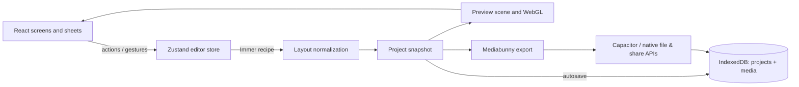
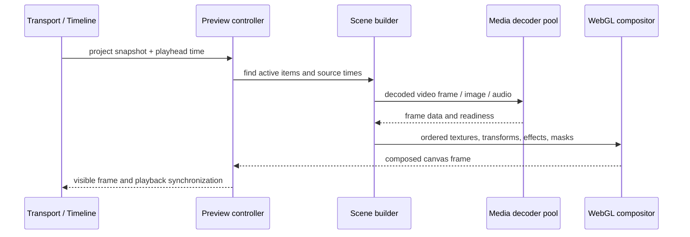

# ReelForge architecture

## Purpose and boundaries

ReelForge is a local-first React video editor packaged in two delivery modes:

- a PWA on GitHub Pages; and
- the same web application in an Android WebView through Capacitor.

The editor, speech recognition, matting, compositing and MP4 encoding run on the
device. JavaScript owns product state and orchestration; browser APIs provide media
decoding, WebCodecs, WebGL2, Web Audio, IndexedDB, file access and workers. Capacitor
adds Android-only file sharing, filesystem access and a native network path. There is
no application server and the persisted project model never needs an account or
upload service.

The main architectural boundary is between:

| Layer | Responsibility | Typical paths |
| --- | --- | --- |
| UI | Screens, sheets, controls, input gestures and feedback | `src/ui/`, `src/state/` |
| Domain model | Serializable project, timeline, media and clip shapes | `src/types.ts` |
| Shared services | Storage, import/download, layout, backups and platform adapters | `src/lib/` |
| Media engine | Deterministic preview, decoding, composition, effects, audio and export | `src/engine/` |
| Delivery shell | Vite/PWA and Capacitor/Android packaging | `vite.config.ts`, `capacitor.config.ts`, `android/` |



## Startup and top-level lifecycle

`src/main.tsx` is the browser and WebView entry point. It initializes appearance and
keyboard tracking, registers the PWA update bridge only for browser builds and mounts
`App` into the root element.

`App` is intentionally small. It chooses one of three history-driven views:

- `Home`: project, clip and appearance management;
- `Studio`: external/direct-media viewing, cropping, clipping and background removal;
- `Editor`: one opened project and its interactive timeline.

Task progress, toasts and dialogs are mounted once above the route so asynchronous
engine operations can report state regardless of which screen started them. Escape
uses history only when the back stack reports an open sheet or dialog.

## State and persistence

The serializable unit of editing is a `Project` from `src/types.ts`. It contains the
output aspect/FPS, background, and four tracks:

- `main`: a sequential visual spine;
- `overlays`: independently timed visual layers;
- `texts`: independently timed text/caption layers;
- `audios`: independently timed audio layers.

Items refer to imported binary files by `mediaId`; they do not embed blobs. This
separates compact, undoable project snapshots from larger media data and keeps
preview/export reads shared through the media service.

The editor Zustand store is the state coordinator:

1. an action receives an Immer draft of the current project;
2. the mutation is followed by layout normalization;
3. the immutable result enters bounded undo history and selection validation;
4. the new snapshot is queued for debounced IndexedDB persistence.

Continuous gestures use a separate gesture baseline. A slider or drag may produce
many intermediate immutable projects but only one history entry when the gesture
ends. Consecutive text-style edits can be coalesced by a merge key. Closing the
editor flushes any pending save before clearing the active project.

IndexedDB owns durable blobs and metadata. Projects, assets and saved clips are
therefore local browser data, including in the Capacitor origin
`https://localhost`. A backup converts that state to one portable `.rfbackup`
document; restore merges it instead of replacing unrelated current data.

## Coordinate and timing model

Timeline time is measured in seconds and is distinct from source-media time:

```text
sourceTime = item.in + (projectTime - item.start) * item.speed
```

This applies to timed video and audio items. Item duration is a timeline duration,
so increasing speed consumes more of the source over the same timeline interval.
Images and text have no source `in` point; their start and duration only determine
visibility.

Main-track placement is sequential. Overlays, text and audio keep explicit start
times and may overlap. Normalization repairs ordering and visibility constraints
after every editor mutation, making action handlers and renderers consume one valid
project shape.

Visual geometry uses fractions of the canvas wherever possible:

- transform `x` and `y` are offsets from the canvas center as fractions of output
  width and height;
- text size, padding, stroke and wrapping use canvas-relative fractions;
- crop edges are source fractions removed from each side;
- keyframe `t` values are relative to the item's own start.

This lets one project be previewed at a CSS-sized canvas and exported at a larger
resolution without changing project coordinates.

## Preview and rendering path



Preview and export share project types and rendering concepts but have different
clocks. Preview follows the browser animation/transport clock and can skip or reuse
frames to remain interactive. Export walks exact output timestamps, so scene
composition, transitions and audio scheduling are repeated for deterministic video
and audio tracks.

The visual stack is ordered by timeline role and layer:

1. background;
2. main-track frame;
3. picture-in-picture/other overlays;
4. styled text and captions.

The scene builder derives active items and source times, while the WebGL layer
handles fit/fill, crop, transforms, masks, blending, filters, adjustments,
transitions and opacity. Text is rasterized into textures and captions can switch
the active word from timing data without mutating the project.

## Audio path

Audio work is separate from visual frame composition. The audio engine maps project
timeline intervals to source time, speed and per-item volume/fades, then mixes the
result for preview or feeds scheduled PCM into the export encoder. Video-item audio
is treated as audio attached to that visual item; audio-track items can overlap it.
Mute and volume are applied at mix time so one source asset can be reused in many
projects without creating modified copies.

Workers keep expensive optional work away from the UI thread:

- the captions worker runs local speech recognition and reports segment/word
  progress;
- the background worker runs the on-device matting model and returns a matte for
  frame processing.

Workers, model assets and WebAssembly are runtime-cached only when used rather than
all being placed in the initial offline precache. Worker messages carry progress and
terminal errors back to task/toast state.

## Import, Studio and saved clips

Import and Studio both produce ordinary media assets; the remainder of the editor
does not depend on where footage came from. The flow is:

1. accept a device file, direct URL, YouTube result or social-platform download;
2. inspect container/track metadata and codec capability;
3. persist the original blob and a `MediaAsset` record;
4. construct a timed item referencing the asset, or save a clip range to the
   reusable clip library.

The clip library stores a clip metadata record and the corresponding encoded
binary. Saving from an editor or Studio creates a new file for the selected range;
the source `start`/`end` values are retained for provenance. Importing that saved
clip into a project then reuses the library binary under one stable `m_<clip id>`
asset ID instead of producing another copy per use. Import adapters report
user-cancelable or platform-specific failures at the UI boundary.

## Export and sharing

Export creates an output stream at the chosen aspect, resolution and frame rate. For
each frame time it asks the scene compositor for a visual frame and samples/mixes
the corresponding audio. Mediabunny/WebCodecs encode the streams into an MP4 or the
best supported configured container. Progress is represented in the global task
pill, and failures are surfaced as user-visible errors rather than partial success.

After completion:

- browser builds download the resulting blob; and
- Capacitor builds can expose the output through the native share/filesystem
  bridge.

Export does not mutate the project, so cancelling or retrying cannot damage editing
state.

## PWA, Capacitor and offline behavior

Vite selects a base path of `/reelforge/` for GitHub Pages and `/` for Capacitor.
The two builds share source, with build-time aliases selecting the stable or
experimental feature adapter.

The PWA precaches the app shell, normal scripts, styles and selected font subsets.
Large AI workers and model/runtime files are excluded from the eager precache and
instead use runtime caches. Browser builds ask before applying a waiting service
worker update. Capacitor builds do not register that worker because APK updates
replace the packaged web bundle.

Android's `MainActivity` is a `BridgeActivity` with no separate native editor. The
origin, package ID and app build variants are treated as persistence invariants:
changing the origin would isolate old IndexedDB data, and changing the package
identity would prevent in-place APK updates.

## Privacy and failure boundaries

Media remains local. Network access is limited to app/model resources and explicit
link/social search/download flows chosen by the user. Captions and automatic subject
cutouts download model files but process the creator's frames locally. The backup
format is not encrypted, so privacy moves to the physical security of any shared
backup file.

Fallible boundaries are:

- codec probing, decoding and encoder support;
- model download/worker initialization;
- native permissions and filesystem/share operations;
- quota exhaustion in IndexedDB or backup creation;
- remote site/container changes.

These boundaries should report errors at their orchestration point, preserve the
last valid project, and clean up temporary workers, blobs, URLs or native caches.

## Extension guide

When adding a feature:

1. extend `src/types.ts` only for genuinely persisted domain state;
2. normalize or migrate old project values at the layout/state boundary;
3. put reusable platform or persistence behavior in `src/lib/`;
4. keep frame/audio algorithms in `src/engine/`;
5. let `src/ui/` orchestrate actions without duplicating engine logic;
6. preserve local processing and add no media-upload dependency;
7. add direct edge-case tests for the new state or engine behavior; and
8. document the module and every non-trivial public/mutating method.

